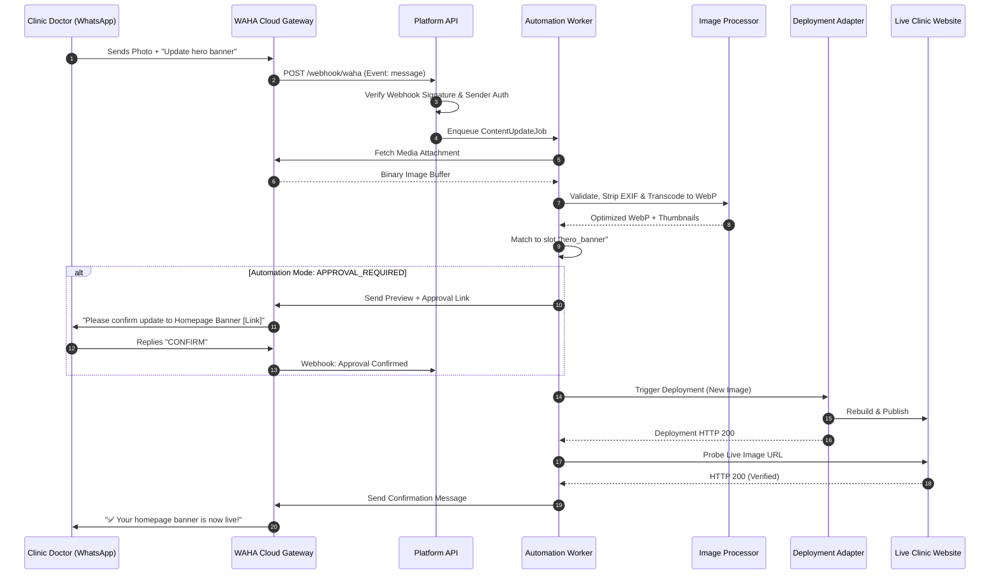

# AUTOMATION_DOCUMENTATION.md — WhatsApp Content & Image Automation Engine
## Standard Operating Procedures for Autonomous Clinical Updates

---

## 1. Purpose
Enable authorized clinic doctors and administrators to update website visual assets (e.g. homepage banner, clinic announcement, equipment photos) directly by sending a WhatsApp message and photo to the clinic's WhatsApp business number, eliminating manual developer intervention.

---

## 2. Trigger
Incoming WAHA webhook event `message` containing:
- An image attachment (`hasMedia: true`).
- A non-empty caption text or associated quoted message containing an explicit update command.

---

## 3. Required Inputs
- Sender WhatsApp JID (`from`, e.g. `919974012606@c.us`).
- Image payload (accessible via WAHA `/api/files/{id}` or base64 stream).
- Command text (e.g. `Update hero banner`, `Change doctor photo`).
- Valid `client_id` associated with the sender.

---

## 4. Authorization & Security Checks
1. Senders must be pre-registered in the `authorized_whatsapp_numbers` table.
2. The sender's phone number must match the specific clinic's `client_id`.
3. Senders without `can_update_content = 1` are rejected immediately.
4. Incoming WAHA webhook signature must match `WAHA_WEBHOOK_SECRET`.

---

## 5. Processing Steps
1. **Webhook Ingestion:** Express route receives `POST /webhook/waha`.
2. **Signature Verification:** Verify HMAC header.
3. **Sender Authentication:** Lookup sender in `authorized_whatsapp_numbers`.
4. **Media Download:** Fetch raw image stream from WAHA media endpoint.
5. **Image Validation:** Inspect file magic bytes, verify JPEG/PNG/WEBP, check size <= 15MB.
6. **Sanitization & Transcoding:** Strip EXIF metadata, transcode to optimized WebP, generate thumbnails.
7. **Intent Parsing:** Match caption to registered `content_slots` (e.g. `hero_banner`, `announcement`).
8. **Automation Mode Evaluation:**
   - If `AUTO_PUBLISH_ALLOWED`: Proceed to deployment.
   - If `APPROVAL_REQUIRED`: Dispatch preview link to doctor WhatsApp with `[Approve] / [Reject]` buttons.
   - If `MANUAL`: Stage update and alert human agency owner.
9. **Version Archival:** Store previous asset pointer in `media_assets` for rollback.
10. **Site Update & Deployment:** Overwrite slot in `clients/<client-id>/content/` and trigger build/deploy.
11. **Live Verification:** Probe the live URL to verify image renders with HTTP 200.
12. **Confirmation Dispatch:** Send verified WhatsApp confirmation to the clinic doctor.

---

## 6. Success Conditions
- New image is visible on the live clinic website.
- Live URL responds with HTTP 200.
- Confirmation WhatsApp message delivered to doctor.
- Entry logged in `audit_logs` with status `SUCCESS`.

---

## 7. Failure Conditions
- Sender phone number not registered.
- Image corrupted or invalid MIME type.
- Ambiguous instruction text.
- Build or cloud deployment fails.
- Live probe fails or returns 404/500.

---

## 8. Retry Behavior
- Webhook network retries: Exponential backoff (1s, 5s, 15s) up to 3 attempts.
- Media download retries: 2 attempts with 2s timeout.
- Deployment retries: 1 retry before initiating automatic rollback.

---

## 9. Logging
Every step is written to `audit_logs`:
```json
{
  "client_id": "clinic-surat-001",
  "actor_phone": "+91 99740 ****06",
  "action": "CONTENT_UPDATE_IMAGE",
  "slot_key": "hero_banner",
  "previous_asset_id": 142,
  "new_asset_id": 143,
  "status": "SUCCESS",
  "timestamp": "2026-11-05T09:00:00Z"
}
```

---

## 10. Monitoring
- Metric: Failed update jobs per hour.
- Alert: If a job fails with `DEPLOYMENT_FAILED`, trigger immediate SMS alert to agency technical lead.

---

## 11. Rollback
If live verification fails post-deployment:
1. System automatically restores the `previous_asset_id` in `content_slots`.
2. Triggers an emergency redeployment.
3. Notifies doctor via WhatsApp: `Your update encountered a deployment error and was safely rolled back. Our technical team has been notified.`

---

## 12. Manual Recovery
In the event of total queue failure:
1. Administrator navigates to Doctor Admin Portal (`/doctor/settings`).
2. Selects **Media History**.
3. Clicks **Restore** on any historical version to force a synchronous redeployment.

---

## 13. Sequence Diagram



