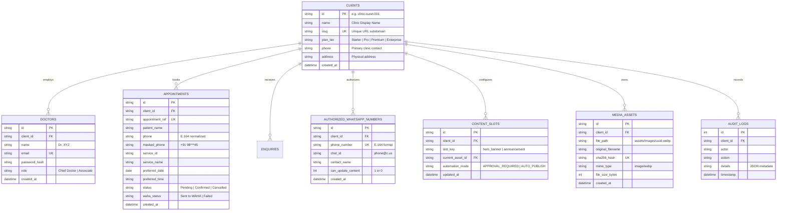

# DATABASE_SCHEMA.md — Multi-Tenant Healthcare Data Architecture
## Schema Specifications, Entity Relationships & Indexing

---

## 1. Entity Relationship Diagram (ERD)



---

## 2. DDL Schema Definition (SQLite & PostgreSQL Compatible)

```sql
-- Clients Table
CREATE TABLE IF NOT EXISTS clients (
  id TEXT PRIMARY KEY,
  name TEXT NOT NULL,
  slug TEXT UNIQUE NOT NULL,
  plan_tier TEXT NOT NULL CHECK(plan_tier IN ('STARTER', 'PROFESSIONAL', 'PREMIUM', 'ENTERPRISE')),
  phone TEXT NOT NULL,
  address TEXT NOT NULL,
  created_at DATETIME DEFAULT CURRENT_TIMESTAMP
);

-- Authorized WhatsApp Senders (For Image Updates)
CREATE TABLE IF NOT EXISTS authorized_whatsapp_numbers (
  id TEXT PRIMARY KEY,
  client_id TEXT NOT NULL REFERENCES clients(id) ON DELETE CASCADE,
  phone_number TEXT UNIQUE NOT NULL,
  chat_id TEXT NOT NULL,
  contact_name TEXT NOT NULL,
  can_update_content INTEGER DEFAULT 0,
  created_at DATETIME DEFAULT CURRENT_TIMESTAMP
);

-- Appointments Table
CREATE TABLE IF NOT EXISTS appointments (
  id TEXT PRIMARY KEY,
  client_id TEXT NOT NULL REFERENCES clients(id) ON DELETE CASCADE,
  appointment_ref TEXT UNIQUE NOT NULL,
  patient_name TEXT NOT NULL,
  phone TEXT NOT NULL,
  masked_phone TEXT NOT NULL,
  service_id TEXT NOT NULL,
  service_name TEXT NOT NULL,
  preferred_date TEXT NOT NULL,
  preferred_time TEXT NOT NULL,
  notes TEXT,
  status TEXT DEFAULT 'Pending' CHECK(status IN ('Pending', 'Confirmed', 'Rescheduled', 'Completed', 'Cancelled')),
  waha_status TEXT DEFAULT 'Not Sent',
  created_at DATETIME DEFAULT CURRENT_TIMESTAMP
);

-- Indexes for High-Speed Multi-Tenant Filtering
CREATE INDEX IF NOT EXISTS idx_appointments_client ON appointments(client_id);
CREATE INDEX IF NOT EXISTS idx_appointments_date ON appointments(preferred_date);
CREATE INDEX IF NOT EXISTS idx_auth_numbers_client ON authorized_whatsapp_numbers(client_id);
```

