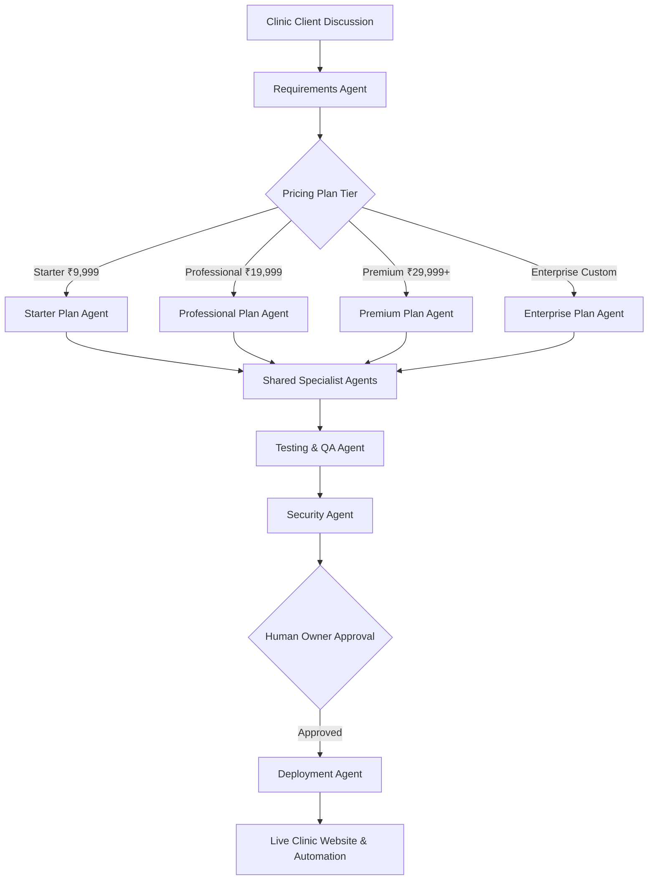

# AI-Powered Clinic Website Development & Automation Platform
## Enterprise Architecture & Multi-Agent Operations System

Welcome to the **AI-Powered Clinic Website Development Platform**, a modular multi-agent system designed to build, deploy, automate, and maintain modern web applications and WhatsApp communication engines for healthcare clinics, dental practices, and specialty doctors.

---

## 1. Quick Navigation & Core Documentation

| Document | Purpose & Description |
| :--- | :--- |
| **[`AGENTS.md`](./AGENTS.md)** | **Global Multi-Agent Operating Constitution**, roles, boundaries, and hierarchy. |
| **[`BUSINESS_PLAN.md`](./BUSINESS_PLAN.md)** | Market strategy, revenue projections, client acquisition, and operational economics. |
| **[`PRICING_PLANS.md`](./PRICING_PLANS.md)** | Feature matrices, delivery limits, and upsell triggers across all 4 tiers (Starter, Pro, Premium, Enterprise). |
| **[`SYSTEM_ARCHITECTURE.md`](./SYSTEM_ARCHITECTURE.md)** | Cloud-agnostic system design, component boundaries, and provider abstraction layer. |
| **[`AUTOMATION_DOCUMENTATION.md`](./AUTOMATION_DOCUMENTATION.md)** | WhatsApp image/content update workflows, safety rules, and sequence diagrams. |
| **[`WAHA_INTEGRATION.md`](./WAHA_INTEGRATION.md)** | WhatsApp HTTP API (WAHA) Docker setup, WebJS engine, and webhook configurations. |
| **[`API_DOCUMENTATION.md`](./API_DOCUMENTATION.md)** | REST API specification, appointment intake endpoints, auth schemas, and health probes. |
| **[`DATABASE_SCHEMA.md`](./DATABASE_SCHEMA.md)** | Multi-tenant relational schema (SQLite & PostgreSQL), entity relationships, and indexes. |
| **[`SECURITY_POLICY.md`](./SECURITY_POLICY.md)** | HIPAA privacy principles, JWT policies, tenant isolation, and webhook signature verification. |
| **[`DEPLOYMENT_GUIDE.md`](./DEPLOYMENT_GUIDE.md)** | Step-by-step cloud deployment (Render, GitHub Pages, VPS) and health check monitoring. |
| **[`MIGRATION_GUIDE.md`](./MIGRATION_GUIDE.md)** | Migration runbook for moving from Render to AWS, DigitalOcean, or private VPS clusters. |
| **[`BACKUP_AND_RECOVERY.md`](./BACKUP_AND_RECOVERY.md)** | Disaster recovery runbooks, WAL checkpoints, and automated backup schedules. |
| **[`TROUBLESHOOTING.md`](./TROUBLESHOOTING.md)** | Comprehensive diagnostic guides, WAHA reconnect steps, and error resolution matrices. |
| **[`CHANGELOG.md`](./CHANGELOG.md)** | Semantic release notes and version history. |

---

## 2. Directory Structure

```text
clinic-website-platform/
├── AGENTS.md                          # Multi-agent operating constitution
├── README.md                          # Project master guide
├── BUSINESS_PLAN.md                   # Market analysis and business model
├── PRICING_PLANS.md                   # 4-tier pricing model and feature gates
├── SYSTEM_ARCHITECTURE.md             # Cloud-agnostic system design
├── AUTOMATION_DOCUMENTATION.md        # WhatsApp content automation workflows
├── WAHA_INTEGRATION.md                # WhatsApp API & Docker engine guide
├── API_DOCUMENTATION.md               # REST API endpoints & schemas
├── DATABASE_SCHEMA.md                 # Data models & multi-tenant isolation
├── SECURITY_POLICY.md                 # Healthcare security & encryption standards
├── DEPLOYMENT_GUIDE.md                # Cloud deployment runbooks
├── MIGRATION_GUIDE.md                 # Cloud migration strategy
├── BACKUP_AND_RECOVERY.md             # Disaster recovery & persistence guides
├── TROUBLESHOOTING.md                 # Diagnostics & error resolution
├── CHANGELOG.md                       # Release notes
│
├── agents/                            # AI Agent specialized instructions
│   ├── main/                          # 4 Plan coordinator agents
│   └── specialists/                   # 14 Shared technical specialists
│
├── platform/                          # Core platform modules & abstractions
│   ├── control-plane/                 # Central registry & client manager
│   ├── client-configs/                # Validated client JSON specifications
│   ├── shared-components/             # Reusable UI widgets & design tokens
│   ├── templates/                     # Vite, HTML5, & Express templates
│   ├── integrations/                  # Third-party SDK wrappers
│   └── deployment-adapters/           # Render, Vercel, & VPS adapters
│
├── services/                          # Microservices & backend components
│   ├── api/                           # Core REST API server
│   ├── whatsapp-gateway/              # WAHA HTTP proxy & webhook handler
│   ├── automation-worker/             # Content & image update queue worker
│   ├── content-service/               # Image optimization & transcoding
│   └── notification-service/          # Email & SMS emergency dispatch
│
├── infrastructure/                    # DevOps & container definitions
│   ├── docker/                        # WAHA & platform Docker compose
│   ├── render/                        # Render blueprints & configs
│   ├── environments/                  # Environment variable templates
│   └── scripts/                       # Maintenance & deployment shell scripts
│
├── clients/                           # Sandboxed client tenant projects
│   └── client-template/               # Standardized starter kit for new clinics
│
├── docs/                              # Deep-dive documentation categories
└── tests/                             # Automated test suites
    ├── unit/
    ├── integration/
    ├── e2e/
    └── security/
```

---

## 3. High-Level Multi-Agent Workflow



---

## 4. Getting Started Locally

### Prerequisites
- Node.js v20+ or v24+
- Docker & Docker Compose (for local WAHA WhatsApp engine)
- pnpm or npm

### Quick Launch
1. Clone the repository and navigate to the platform directory:
   ```bash
   cd clinic-website-platform
   ```
2. Copy environment templates:
   ```bash
   cp infrastructure/environments/.env.example .env
   ```
3. Start the local WAHA Docker container:
   ```bash
   docker compose -f infrastructure/docker/docker-compose.yml up -d
   ```
4. Access the local WAHA dashboard at `http://localhost:3008/dashboard` (`admin` / `DoctorXYZ@2026`).

