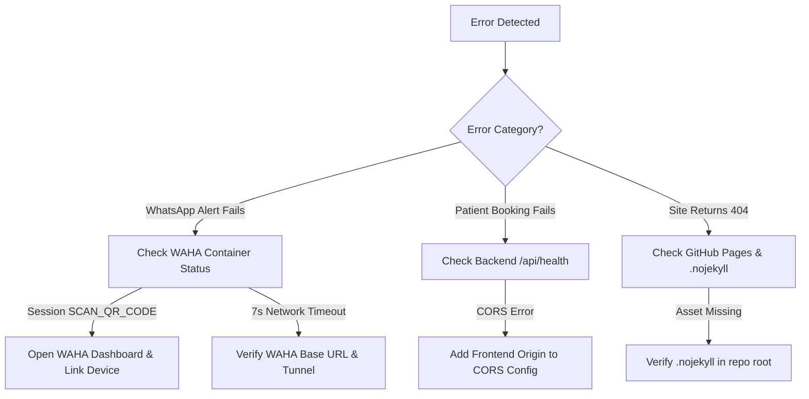

# TROUBLESHOOTING.md — Diagnostics & Error Resolution Matrix
## Root Causes, Quick Fixes & Triage Commands

---

## 1. Quick Diagnostic Flowchart

---

## 2. Common Errors & Exact Resolutions

### Error 1: `Network timeout while contacting WAHA server (7s exceeded)`
- **Root Cause:** Backend is pointing to an expired Cloudflare quick tunnel or unreachable WAHA container.
- **Resolution:**
  1. Inspect `WAHA_BASE_URL` in environment variables.
  2. For cloud deployments, point to the internal service: `http://waha-whatsapp-service:3000`.
  3. For local development, verify Docker container is running (`docker ps | grep waha`).

### Error 2: `WAHA: AUTH_FAILED` (HTTP 401 / 403)
- **Root Cause:** Container generated a random key on restart, or `WAHA_API_KEY` in backend `.env` does not match container environment.
- **Resolution:** Explicitly set a permanent fixed key `-e WAHA_API_KEY=50100d00397b43cdb9f8a61599cd2f94` in both Docker and `.env`.

### Error 3: `Unknown named parameter 'fromMe'` (SQLite Error)
- **Root Cause:** WAHA WebJS returned message `id` as an object `{ fromMe: true, id: '...' }` rather than a string. Passing this object into SQLite queries caused SQLite to interpret it as named parameters.
- **Resolution:** Ensure code extracts stringified ID: `const msgId = typeof res.id === 'object' ? (res.id._serialized || res.id.id) : res.id;`.

### Error 4: GitHub Pages 404 on Vite Assets
- **Root Cause:** Jekyll processing ignores directories or files starting with underscores or specific names.
- **Resolution:** Verify `.nojekyll` file exists in the repository root.
